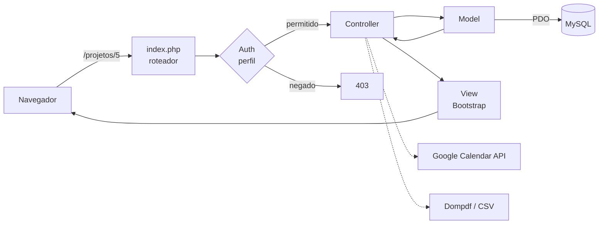
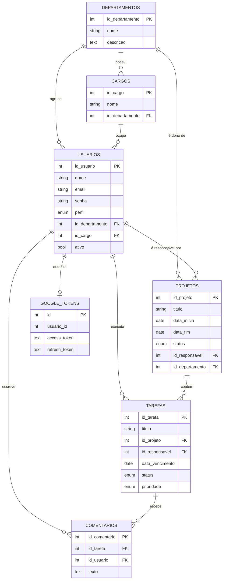

<div align="center">

# GESTIQ

**Sistema web de gestão de tarefas e projetos para equipes, com controle de acesso por perfil, relatórios em PDF e integração com o Google Calendar.**


</div>

---

## Sobre o projeto

O GESTIQ centraliza a rotina de uma equipe em um só lugar: departamentos, cargos, pessoas, projetos, tarefas, comentários e agenda. Cada usuário vê e faz apenas o que o seu perfil permite, e a gestão acompanha o andamento por meio de um painel e de relatórios exportáveis.

Foi desenvolvido como projeto acadêmico do curso de Ciência da Computação do **CEUB**, em PHP puro com arquitetura MVC, sem frameworks, para exercitar a base de desenvolvimento web: roteamento, acesso a banco com PDO, sessões, autenticação e autorização.

## Telas

> As imagens ficam em [`docs/screenshots/`](docs/screenshots/).

| Login | Painel |
| --- | --- |
|  |  |

| Projetos | Tarefas |
| --- | --- |
|  |  |

| Relatórios | Agenda |
| --- | --- |
|  |  |

## Funcionalidades

- **Autenticação:** login, cadastro e recuperação de senha, com senhas criptografadas (`password_hash`) e sessão regenerada no login.
- **Controle de acesso por perfil:** administrador, gestor e colaborador, com permissões verificadas no servidor.
- **Departamentos e cargos:** estrutura organizacional da equipe.
- **Usuários:** cadastro, edição, ativação e definição de perfil.
- **Projetos:** cadastro com datas, responsável, departamento e status (planejamento, em andamento, concluído, cancelado).
- **Tarefas:** atribuição a responsáveis, prazo, prioridade (baixa a crítica) e status.
- **Comentários:** discussão dentro de cada tarefa.
- **Painel:** visão geral de projetos e tarefas.
- **Relatórios:** filtros por projeto e tarefa, com exportação em **PDF** (Dompdf) e **CSV**.
- **Agenda:** criação de eventos no **Google Calendar** via OAuth 2.0 e geração de arquivos `.ics`.

## Tecnologias

| Camada | Tecnologia |
| --- | --- |
| Back-end | PHP 8 com arquitetura MVC própria (sem framework) |
| Banco de dados | MySQL / MariaDB com PDO e prepared statements |
| Front-end | HTML, CSS e Bootstrap 5, Bootstrap Icons |
| Relatórios | Dompdf (PDF) e exportação CSV |
| Integrações | Google API Client (Google Calendar, OAuth 2.0) |
| Dependências | Composer |
| Ambiente local | XAMPP (Apache + MySQL + PHP) |

## Arquitetura

Todas as requisições passam por um único ponto de entrada (`index.php`), que interpreta a rota e chama o controller correspondente. O controller valida o acesso, usa os models para ler e gravar no banco e entrega os dados para a view.



```
├── controllers/   regras de cada tela (Projetos, Tarefas, Usuários, Relatórios...)
├── models/        acesso ao banco com PDO
├── views/         páginas em PHP + Bootstrap, organizadas por módulo
├── helpers/       autenticação e autorização (Auth)
├── config/        configuração lida do .env e conexão com o banco
├── database/      schema.sql e seed.sql com dados fictícios
├── public/        CSS e imagens
├── scripts/       criação do administrador pelo terminal
└── index.php      roteador (ponto de entrada)
```

## Modelo de dados



## Perfis de acesso

| Ação | Administrador | Gestor | Colaborador |
| --- | :---: | :---: | :---: |
| Ver painel, projetos e tarefas | Sim | Sim | Sim |
| Comentar em tarefas | Sim | Sim | Sim |
| Editar as próprias tarefas | Sim | Sim | Sim |
| Criar e editar projetos, cargos e tarefas da equipe | Sim | Sim | Não |
| Ver usuários e gerar relatórios (PDF e CSV) | Sim | Sim | Não |
| Excluir projetos e cargos | Sim | Não | Não |
| Cadastrar e gerenciar usuários | Sim | Não | Não |
| Editar ou excluir comentários de outras pessoas | Sim | Não | Não |

## Como rodar localmente

**Requisitos:** PHP 8+, MySQL ou MariaDB, Apache com `mod_rewrite` (o XAMPP já inclui tudo) e Composer.

1. **Clone o repositório** dentro da pasta do Apache:
   ```bash
   cd "C:\xampp\htdocs"
   git clone https://github.com/Mariaclara2424/Gestiq.git gestiq
   ```
2. **Instale as dependências:**
   ```bash
   cd "C:\xampp\htdocs\gestiq"
   composer install
   ```
3. **Crie o banco** com a estrutura e os dados de exemplo:
   ```bash
   cd "C:\xampp\htdocs\gestiq"
   mysql -u root -p < database/schema.sql
   mysql -u root -p gestiq < database/seed.sql
   ```
4. **Configure o ambiente:** copie `.env.example` para `.env` e preencha os dados do seu banco.
5. **(Opcional) Google Calendar:** crie um cliente OAuth no Google Cloud Console, ative a Google Calendar API, baixe o `credentials.json`, salve **fora do repositório** e informe o caminho em `GOOGLE_CREDENTIALS_PATH` no `.env`.
6. **Acesse** `http://localhost/gestiq` e entre com um usuário de exemplo:

   | E-mail | Perfil | Senha |
   | --- | --- | --- |
   | `admin@gestiq.com` | Administrador | `gestiq123` |
   | `joao@gestiq.com` | Gestor | `gestiq123` |
   | `maria@gestiq.com` | Colaborador | `gestiq123` |

   Para criar um administrador seu, defina `ADMIN_EMAIL` e `ADMIN_PASSWORD` no `.env` e rode `php scripts/setup_admin.php`.

## Segurança

- Credenciais ficam no `.env`, fora do controle de versão (veja o [`.env.example`](.env.example)).
- Consultas ao banco com PDO e *prepared statements*.
- Senhas armazenadas com `password_hash` e verificadas com `password_verify`.
- Permissões verificadas no servidor em cada ação, não só escondidas na tela.
- `.htaccess` bloqueia o acesso direto a arquivos e pastas internas.

## O que aprendi

- Montar uma arquitetura MVC do zero, entendendo o que os frameworks fazem por baixo.
- Modelar um banco relacional com chaves estrangeiras e regras de exclusão.
- Implementar autenticação, sessões e autorização por perfil.
- Integrar uma API externa com OAuth 2.0 e renovação automática de tokens.
- Gerar relatórios em PDF e CSV a partir de consultas filtradas.
- Cuidar de segredos e configuração por ambiente em um repositório público.

## Próximos passos

- Proteção contra CSRF nos formulários.
- Recuperação de senha com envio real de e-mail.
- Testes automatizados com PHPUnit.
- Associar o token do Google ao usuário logado, em vez de um usuário fixo.

## Autoras

| | |
| --- | --- |
| **Maria Clara Pedrosa** | [@Mariaclara2424](https://github.com/Mariaclara2424) |
| **Lívia Pacheco** | [@livmoorais](https://github.com/livmoorais) |

Projeto acadêmico desenvolvido no curso de Ciência da Computação do **CEUB – Centro Universitário de Brasília**.

## Licença

Distribuído sob a licença MIT. Veja [LICENSE](LICENSE).
